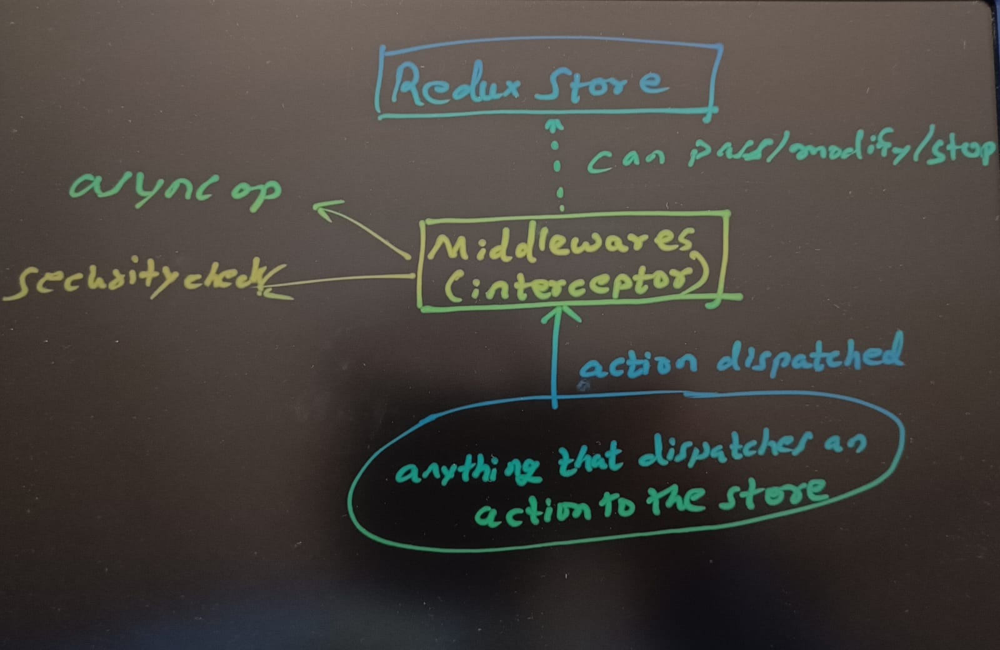

# Middlewares

- Middlewares *intercepts* actions in the dispatch pipeline of Redux

- They are ideal for performing logging, error handling, and making network or
database calls before the state is changed

- You can also chain a sequence of middlewares together with each layer
performing a different action

- Therefore, allowing you to modify or stop a call altogether if something goes
wrong
