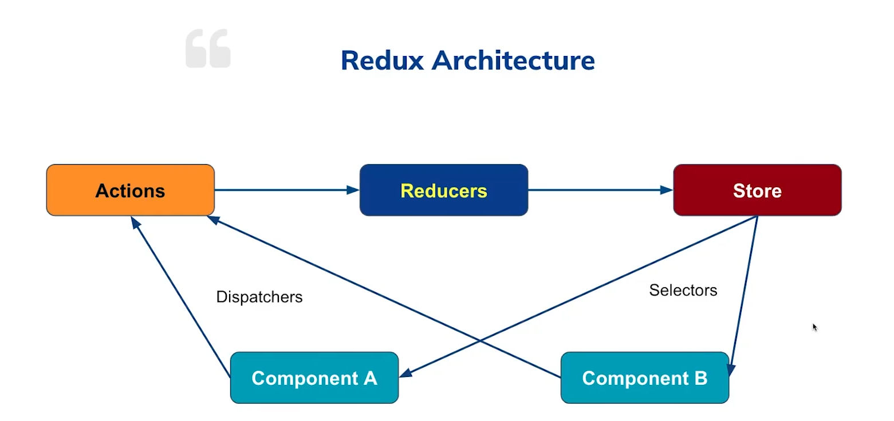

# Introduction to Redux

- It is a *third-party state management library* that handles complex and
dynamic state efficiently

- It can be used with vanilla JS, React or any other UI framework or library

## How it Works

- It exposes data through the store but exposes state mutation logic through
deterministic actions

- These actions are translated by reducers that are *pure functions*

- This makes state mutation predictable and reliable
